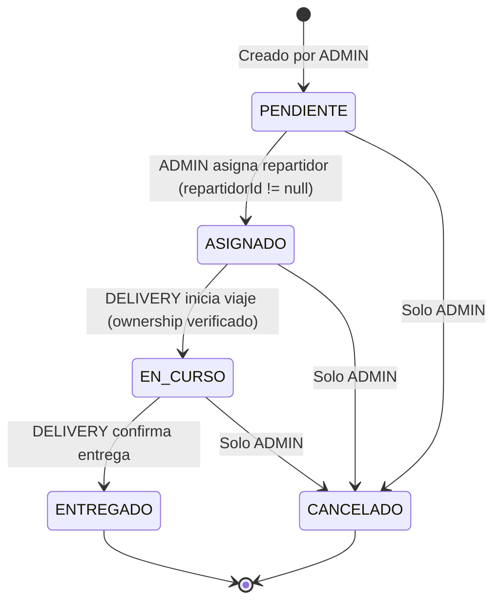
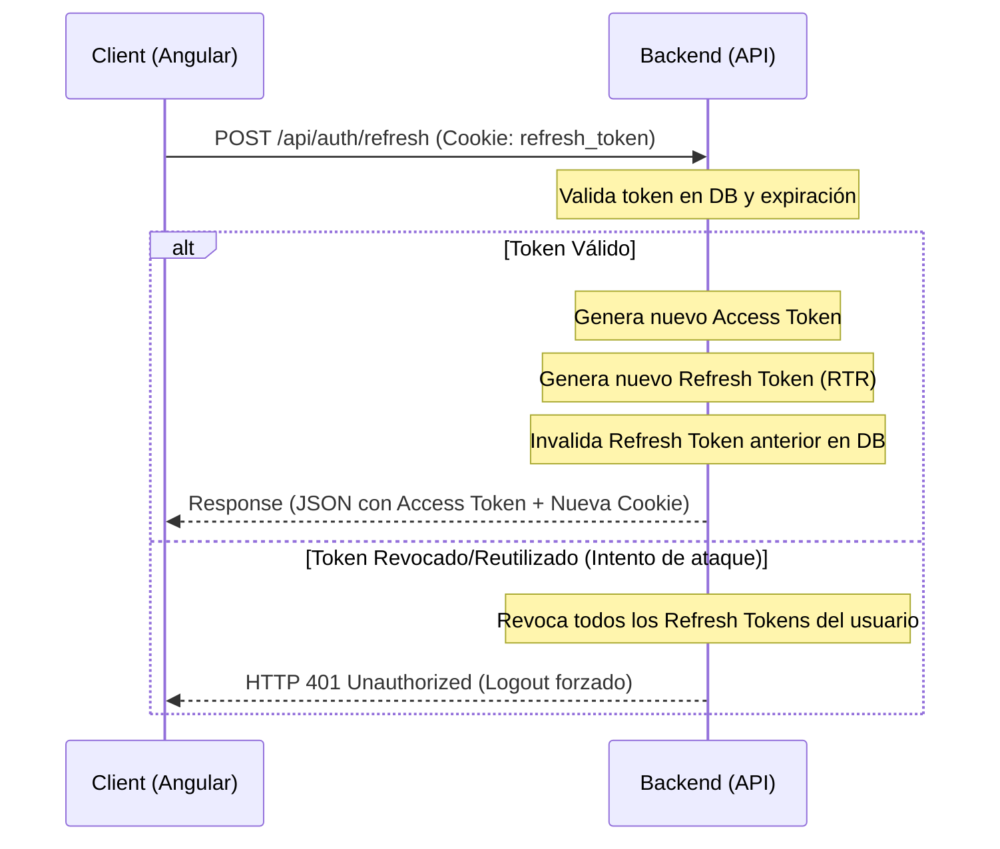

# DeliveryHub - Backend Service

¡Bienvenido al core de **DeliveryHub**! Este servicio backend está diseñado bajo los principios de **Clean Architecture** (Arquitectura Limpia) utilizando **Java 21** y **Spring Boot 3**. Su objetivo principal es centralizar la gestión de pedidos de comida, gestionar la logística interna de repartidores y ofrecer actualizaciones en tiempo real a través de WebSockets (STOMP).

---

## Arquitectura del Sistema (Clean Architecture)

El backend sigue un flujo de dependencias estrictamente unidireccional hacia el centro (el Dominio). Las capas están estructuradas para que la lógica de negocio esté completamente desacoplada de la base de datos, del framework de presentación y de cualquier cliente externo.

```
       ┌────────────────────────────────────────────────────────┐
       │ Presentation Layer (Controllers REST & WebSockets)     │
       └───────────────────┬────────────────────────────────────┘
                           │ (usa)
                           ▼
       ┌────────────────────────────────────────────────────────┐
       │ Application Layer (Use Cases & Ports)                  │
       └───────────────────┬────────────────────────────────────┘
                           │ (usa/implementa)
                           ▼
       ┌────────────────────────────────────────────────────────┐
       │ Domain Layer (Entidades & Reglas Puras)                │
       └────────────────────────────────────────────────────────┘
                           ▲
                           │ (implementa Ports)
       ┌───────────────────┴────────────────────────────────────┐
       │ Infrastructure Layer (JPA Repositories, Config, OSRM)  │
       └────────────────────────────────────────────────────────┘
```

### Estructura de Paquetes Recomendada

```text
deliveryhub-backend/
├── src/
│   ├── main/
│   │   ├── java/
│   │   │   └── com/
│   │   │       └── deliveryhub/
│   │   │           ├── domain/                 <-- Capa de Dominio (Java Puro)
│   │   │           │   ├── model/              <-- Pedido, Usuario, Direccion, EstadoPedido, RefreshToken
│   │   │           │   └── exception/          <-- Excepciones de negocio (DomainExceptions, RefreshTokenExpiredException)
│   │   │           │
│   │   │           ├── application/            <-- Capa de Aplicación
│   │   │           │   ├── usecase/            <-- Casos de uso (Orquestadores de la lógica)
│   │   │           │   │   ├── CrearPedidoUseCase.java
│   │   │           │   │   ├── AsignarLotePedidoUseCase.java
│   │   │           │   │   ├── ActualizarEstadoPedidoUseCase.java
│   │   │           │   │   └── RefreshSessionUseCase.java
│   │   │           │   └── port/               <-- Puertos (Interfaces de entrada/salida)
│   │   │           │       ├── input/          <-- Interfaces que llaman los controladores
│   │   │           │       └── output/         <-- Interfaces que implementa la infraestructura (ej: RefreshTokenRepositoryPort)
│   │   │           │
│   │   │           ├── presentation/           <-- Capa de Presentación (Adaptadores de Entrada)
│   │   │           │   ├── controller/         <-- RestControllers (AuthController, PedidoController) y MessageMapping
│   │   │           │   ├── dto/                <-- Request/Response DTOs (LoginRequest, TokenResponse)
│   │   │           │   ├── mapper/             <-- MapStruct mappers
│   │   │           │   └── exception/          <-- ExceptionHandler global
│   │   │           │
│   │   │           └── infrastructure/         <-- Capa de Infraestructura (Adaptadores de Salida)
│   │   │               ├── adapter/            <-- Implementación de repositorios (JpaRefreshTokenRepository) y servicios externos
│   │   │               ├── config/             <-- SecurityConfig, WebSocketConfig, AppConfig
│   │   │               └── entity/             <-- Entidades JPA para PostgreSQL (RefreshTokenEntity)
│   │   └── resources/
│   │       ├── db/
│   │       │   └── migration/                  <-- Migraciones SQL de Flyway (V1__init.sql, V2__create_refresh_tokens.sql)
│   │       └── application.yml                 <-- Configuración del sistema (JWT, DB, WS)
├── Dockerfile
├── docker-compose.yml
└── pom.xml
```

---

## Máquina de Estados del Pedido

El ciclo de vida de un pedido está estrictamente validado en la capa de dominio. Cualquier intento de violar la secuencia de estados resultará en un error HTTP `422 Unprocessable Entity`.



### Reglas de Negocio Relacionadas:
- **Transición Secuencial**: No se permiten saltos (ej. `PENDIENTE` -> `ENTREGADO`).
- **Irrevertible**: Una vez que un pedido está en estado `ENTREGADO` o `CANCELADO`, no se puede volver a un estado anterior.
- **Asignación Única**: Solo se puede asignar un repartidor si el pedido está en estado `PENDIENTE`.
- **Ownership de Delivery**: Un usuario con rol `DELIVERY` solo puede modificar el estado de pedidos que tenga asignados (`repartidorId == usuario_autenticado.id`).

---

## Modelo de Seguridad & JWT

El backend implementa autenticación **stateless** utilizando **Spring Security** y **JSON Web Tokens (JWT)** para la autorización de endpoints, complementado con un sistema de **Refresh Tokens** persistidos en base de datos para la gestión y renovación de sesiones seguras.

### Ciclo de Vida de los Tokens
1. **Access Token (JWT):** Corta duración (ej: 15 minutos). Almacenado en memoria en el cliente (Angular). Se envía en el header `Authorization: Bearer <token>`.
2. **Refresh Token:** Larga duración (ej: 7 días). Persistido en base de datos PostgreSQL y enviado al cliente en una cookie **HttpOnly, Secure y SameSite=Strict** para protegerlo de ataques XSS.

---

### Flujo de Refresh Token & Rotación (RTR)

Para maximizar la seguridad, implementamos **Refresh Token Rotation (RTR)**. Cada vez que se solicita un nuevo Access Token, el Refresh Token actual se invalida y se genera uno nuevo.



### Tabla de Base de Datos `refresh_tokens`
```sql
CREATE TABLE refresh_tokens (
    id UUID PRIMARY KEY,
    token VARCHAR(255) UNIQUE NOT NULL,
    user_id UUID NOT NULL REFERENCES usuarios(id) ON DELETE CASCADE,
    expiry_date TIMESTAMP NOT NULL,
    revoked BOOLEAN NOT NULL DEFAULT FALSE,
    created_at TIMESTAMP NOT NULL DEFAULT CURRENT_TIMESTAMP,
    FOREIGN KEY (user_id) REFERENCES usuarios(id)
);
```

---

### Endpoints de Autenticación Core
- `POST /api/auth/login`: Autentica al usuario. Retorna el Access Token en el JSON body y el Refresh Token en la cookie `refresh_token`.
- `POST /api/auth/refresh`: Valida la cookie `refresh_token`, rota el token en DB y retorna un nuevo Access Token y Refresh Token.
- `POST /api/auth/logout`: Revoca el Refresh Token en la base de datos y borra la cookie del cliente.

---

### Control de Acceso por Roles (Endpoints de Negocio)
- `POST /api/pedidos`: Acceso restringido a `ADMIN`.
- `PUT /api/pedidos/{id}/asignar`: Acceso restringido a `ADMIN`.
- `PATCH /api/pedidos/{id}/estado`:
  - Si el rol es `DELIVERY`, se valida en el caso de uso que sea el dueño asignado del pedido.
  - Si el rol es `ADMIN`, permite transiciones administrativas o cancelaciones directas.

---

## Tiempo Real con WebSockets (STOMP)

Para evitar el *polling* constante y garantizar una óptima experiencia de usuario, las actualizaciones de pedidos se notifican a través de WebSockets utilizando el protocolo **STOMP** sobre **SockJS**.

- **Handshake Autenticado**: El handshake inicial del WebSocket intercepta la petición y valida el JWT enviado en los headers o query params.
- **Canales de Mensajería (Destinations)**:
  - `/topic/admin/pedidos`: Canal público para administradores. Notifica cambios de estado de cualquier pedido y geolocalizaciones en tiempo real de todos los repartidores activos.
  - `/user/{repartidorId}/pedidos`: Canal privado para cada repartidor. Notifica la asignación de nuevos pedidos o cancelaciones directamente a su dispositivo.

---

## Base de Datos (PostgreSQL & Flyway)

La persistencia de datos está manejada por PostgreSQL. Flyway se encarga del versionado y migración de esquemas.

### Tablas Principales:
1. **`usuarios`**: Almacena credenciales, hash de contraseña (BCrypt), nombre y rol (`ADMIN`, `DELIVERY`).
2. **`pedidos`**: Registra la descripción del pedido, el estado actual (`PENDIENTE`, `ASIGNADO`, `EN_CURSO`, `ENTREGADO`, `CANCELADO`), timestamps de creación/modificación, monto y referencias de clave foránea.
3. **`direcciones`**: Almacena calle, número, latitud y longitud. Adicionalmente, cuenta con el campo geográfico adecuado para escalar a PostGIS en iteraciones post-MVP.

---

## Requisitos e Instalación Local

### Requisitos Previos:
- **Java 21 JDK**
- **Maven 3.9+**
- **Docker & Docker Compose**

### Paso 1: Levantar Infraestructura Local (Base de datos y pgAdmin)
Desde la raíz del backend ejecuta:
```bash
docker-compose up -d
```
Esto iniciará:
- **PostgreSQL** en el puerto `5432` con una base de datos llamada `deliveryhub`.
- **pgAdmin 4** en `http://localhost:5050` para administrar visualmente los datos.

### Paso 2: Compilar y Ejecutar Tests Unitarios
Para garantizar el correcto funcionamiento de las validaciones de negocio en la máquina de estados:
```bash
mvn clean test
```

### Paso 3: Iniciar el Servicio Backend
```bash
mvn spring-boot:run
```
El servicio estará disponible en `http://localhost:8080`.

---

## Roadmap de Trabajo (Backend)

- [ ] **Fase 1**: Crear estructura de paquetes y configurar `application.yml` junto con Docker Compose.
- [ ] **Fase 2**: Implementar base de dominio (`Pedido.java`, `EstadoPedido.java`) y levantar migraciones Flyway iniciales.
- [ ] **Fase 3**: Integrar Spring Security y generación/validación de tokens JWT.
- [ ] **Fase 4**: Implementar Casos de Uso y endpoints REST básicos de creación y consulta.
- [ ] **Fase 5**: Implementar WebSocket Config + interceptor JWT y testear flujo en tiempo real.
- [ ] **Fase 6**: Completar cobertura de pruebas unitarias y de integración.
