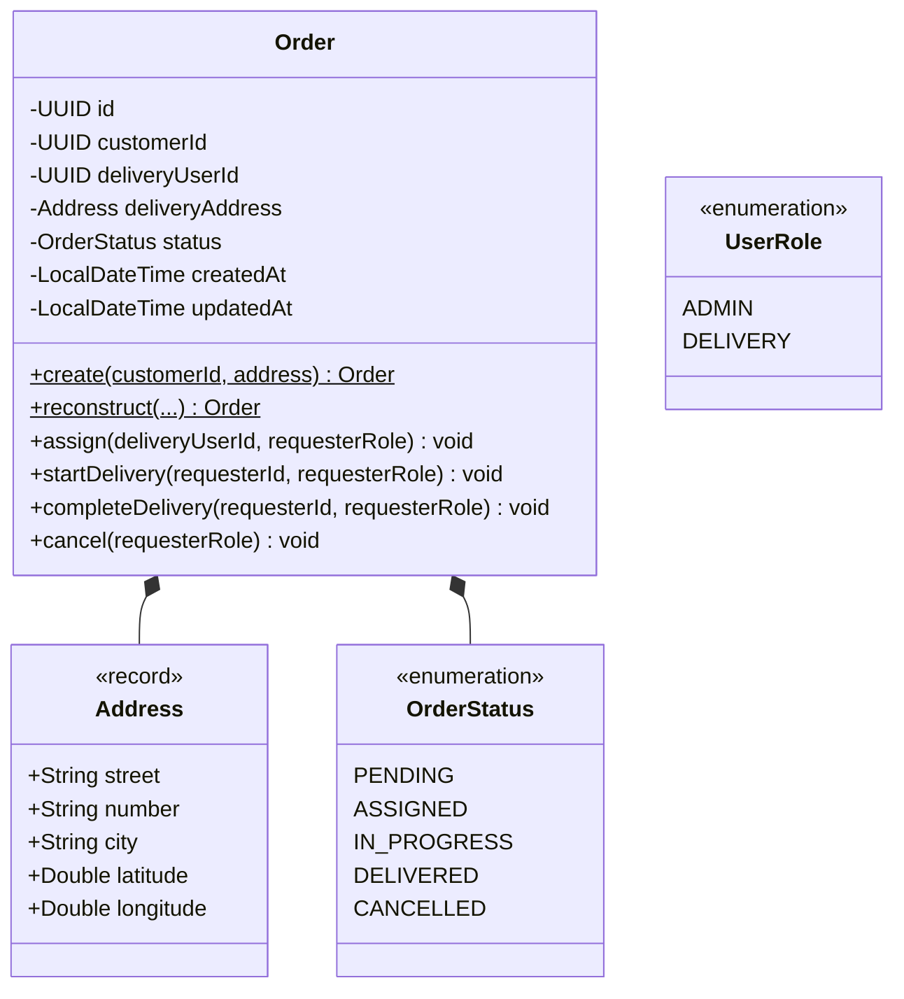

# Technical Design: Phase 2 - Domain Layer

## Goal
Implement the core domain model for the Order domain, ensuring business rules, state transitions, and role-based access are encapsulated and validated within the aggregate root.

## Architecture

Following Clean Architecture and DDD principles, the domain layer will be pure Java, with no dependencies on external frameworks (Spring, JPA, etc.).

## Components

### 1. Enums (`com.deliveryhub.domain.enums`)

#### `OrderStatus`
- `PENDING`: Initial state.
- `ASSIGNED`: Order has a delivery user assigned.
- `IN_PROGRESS`: Delivery user has started the delivery.
- `DELIVERED`: Terminal state (Success).
- `CANCELLED`: Terminal state (Failure).

#### `UserRole`
- `ADMIN`
- `DELIVERY`

### 2. Value Objects (`com.deliveryhub.domain.model`)

#### `Address` (Java Record)
- `String street`
- `String number`
- `String city`
- `Double latitude`
- `Double longitude`

**Validation Logic**:
- Street, number, and city must not be null or blank.
- Latitude must be between -90 and 90.
- Longitude must be between -180 and 180.

### 3. Aggregate Root (`com.deliveryhub.domain.model`)

#### `Order`
- `UUID id` (final)
- `UUID customerId` (final)
- `UUID deliveryUserId`
- `Address deliveryAddress` (final)
- `OrderStatus status`
- `LocalDateTime createdAt` (final)
- `LocalDateTime updatedAt`

**Factories**:
- `public static Order create(UUID customerId, Address address)`: Used for new orders. Sets `id`, `customerId`, `address`, `status = PENDING`, `createdAt`, and `updatedAt`.
- `public static Order reconstruct(...)`: Used by the infrastructure layer to restore the aggregate from persistence.

**State Transition Logic**:
- `public void assign(UUID deliveryUserId, UserRole requesterRole)`:
    - Validate `requesterRole == ADMIN`.
    - Validate current status is `PENDING`.
    - Set `this.deliveryUserId = deliveryUserId`, `status = ASSIGNED`.
- `public void startDelivery(UUID requesterId, UserRole requesterRole)`:
    - Validate `requesterRole == DELIVERY`.
    - Validate `requesterId == this.deliveryUserId`.
    - Validate current status is `ASSIGNED`.
    - Set `status = IN_PROGRESS`.
- `public void completeDelivery(UUID requesterId, UserRole requesterRole)`:
    - Validate `requesterRole == DELIVERY`.
    - Validate `requesterId == this.deliveryUserId`.
    - Validate current status is `IN_PROGRESS`.
    - Set `status = DELIVERED`.
- `public void cancel(UserRole requesterRole)`:
    - Validate `requesterRole == ADMIN`.
    - Validate status is NOT `DELIVERED` or `CANCELLED`.
    - Set `status = CANCELLED`.

### 4. Domain Exceptions (`com.deliveryhub.domain.exception`)

- `InvalidStatusTransitionException`: Thrown when a transition is attempted between incompatible states.
- `UnauthorizedTransitionException`: Thrown when a user attempts a transition they are not authorized for (role or ownership).

## Class Diagram (Conceptual)

## Validation & Business Rules

- **Immutability**: Terminal states (`DELIVERED`, `CANCELLED`) prevent any further modifications.
- **Ownership**: `DELIVERY` users can only transition orders assigned to them.
- **Role Control**: Only `ADMIN` can assign or cancel orders.

## Testing Strategy

- **Unit Tests**:
    - `OrderTest`: Exhaustive testing of the state machine, role-based transitions, and unauthorized access attempts.
    - `AddressTest`: Validation of coordinate ranges and non-blank fields.
